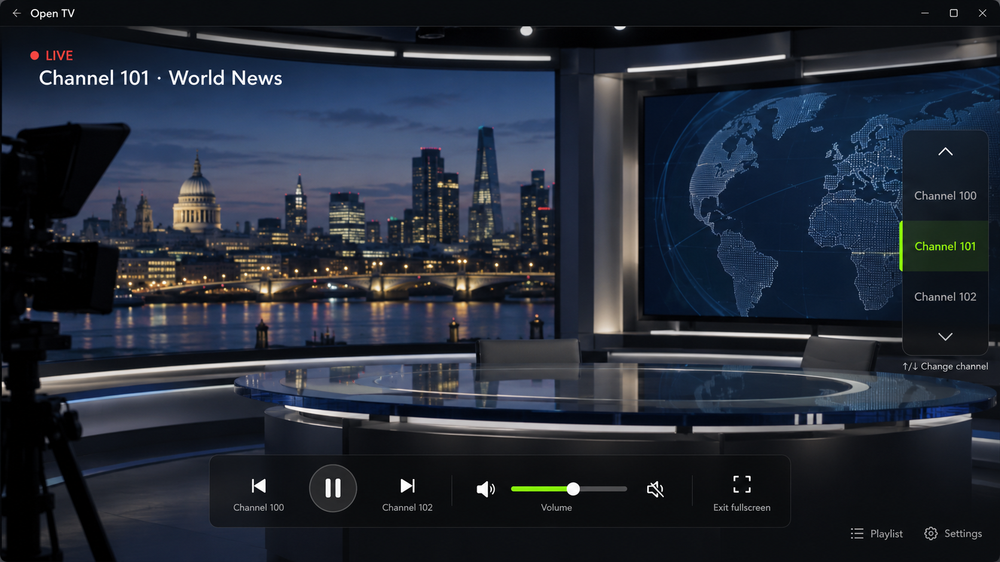
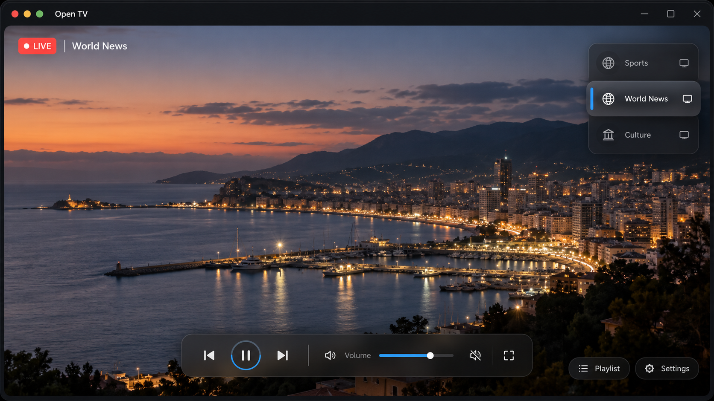

# PC 端界面效果图与功能分区

## 当前效果图

文件：`open-tv-pc-mockup-v2-tv-first.png`

这版效果图是当前界面基线：视频占据绝大部分窗口，底部控制条展示播放、上下换台、音量、静音和全屏；频道浏览通过操作时打开的频道抽屉完成，不在播放画面右侧常驻频道条。频道名称、节目内容和 Logo 都是示意数据，不代表最终内置频道或授权内容。早期版本保留为 `open-tv-pc-mockup-v1.png`，仅用于对比。

## Apple TV 启发的视觉重构（v3）

文件：`open-tv-pc-mockup-v3-apple-inspired.png`

这张图是 v3 的视觉基线，代码已按此方向落地。它保留播放画面为绝对主体，借鉴 Apple TV 的深石墨背景、半透明材质、边缘安全留白和清晰焦点状态：白色表示当前焦点，蓝色只表示可操作强调，红色只表示 LIVE 或错误。控制 Dock、频道抽屉和 Settings 入口仍然是 Open TV 的直播场景专用设计。

## 播放舞台布局重构（v4）

v5 将播放舞台统一为 TV-first 布局：视频画布全屏铺开，频道号、频道名和分组位于左上安全区，控制 Dock 居中并按大屏安全区收敛。Settings 使用带遮罩的居中模态覆盖层，来源管理直接放在同一覆盖层内；桌面端和后续 Android TV 共用这套信息结构，播放逻辑、播放器适配器和数据模型保持不变。

## 界面分区

| 区域 | 功能规划 | 对应模块 |
| --- | --- | --- |
| 播放画面 | M3U8/HLS 视频、加载/失败状态、当前频道和 LIVE | `PlaybackView` |
| 短暂 OSD | 上下换台、音量、静音、播放/暂停、全屏 | `PlaybackControls` / `OsdLayer` |
| 频道抽屉 | 搜索、分组和快速换台 | `ChannelDrawer` |
| Settings 覆盖层 | 添加 URL、导入本地 M3U、刷新、删除、切换来源、播放偏好、稳定性和诊断导出 | `SettingsDrawer` |
| EPG（预留） | 数据模型和解析能力保留，当前 PC 版本不展示 | 后续高级功能 |

## 视觉与交互基线

- 深色背景，降低长时间观看时的视觉疲劳。
- 深石墨背景和半透明材质承载长时间观看；Apple TV 风格的蓝色只用于可操作强调，白色高亮和轻微放大表示频道/控件焦点。
- 红色只表示 LIVE 状态或错误，避免用强调色表达多个语义。
- 播放区优先占据主要空间，频道浏览通过抽屉访问，不永久遮挡当前播放。
- 频道切换使用上下键或频道抽屉，主播放区不再常驻右上频道列表；底部播放 Dock 只保留一个 Settings 管理入口，播放列表管理从 Settings 内进入。
- 播放中无操作 4 秒后，频道标题、控制 Dock 和 Settings 入口自动淡出；鼠标移动、点击、键盘或焦点操作会重新显示。
- 音量区使用单个 SVG 扬声器图标配合滑块，静音按钮使用独立的扬声器叉号图标，不使用文字代替声音图标。
- PC 端支持鼠标、键盘快捷键和窗口全屏；Android TV 复用同一布局并将输入替换为遥控器焦点导航。
- 主播放区采用全屏沉浸式画布；频道号、频道名和分组位于左上安全区，底部控制 Dock 居中并按大屏安全区定位。
- Settings 使用右侧模态覆盖层，PC 与 Android TV 共用信息结构；覆盖层内部滚动，主播放区不重新排版。
- EPG 来源暂不在桌面设置中暴露；共享模型和解析器保留，等有稳定授权来源后再恢复。
